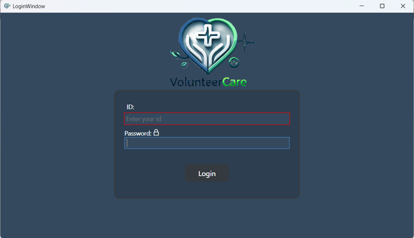
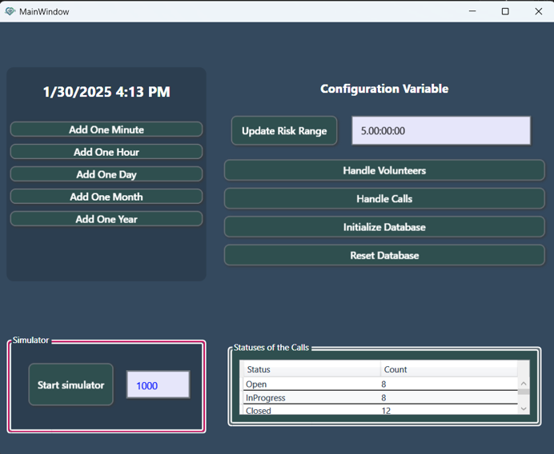
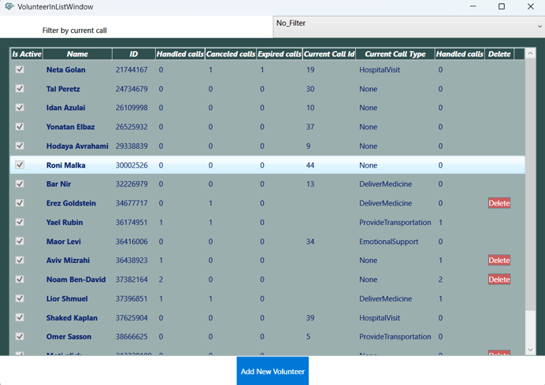
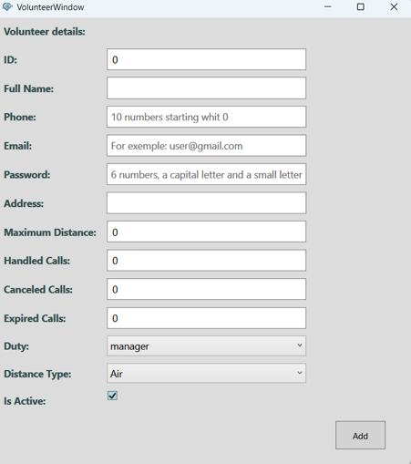
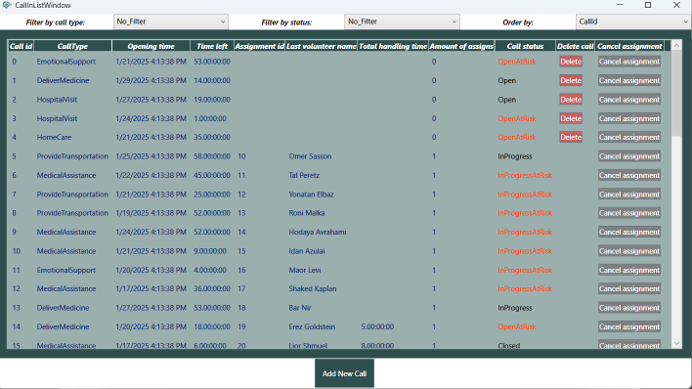
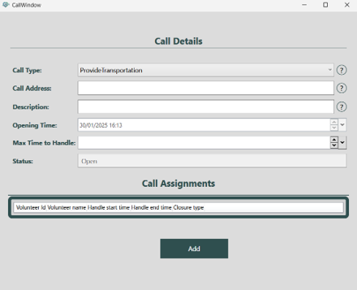
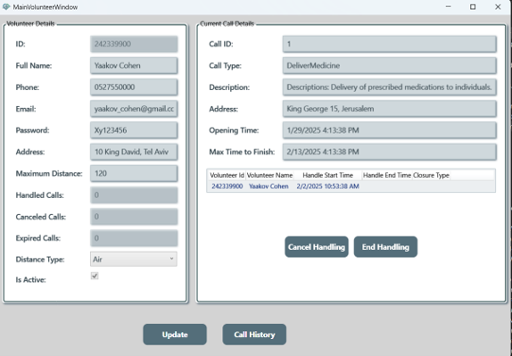
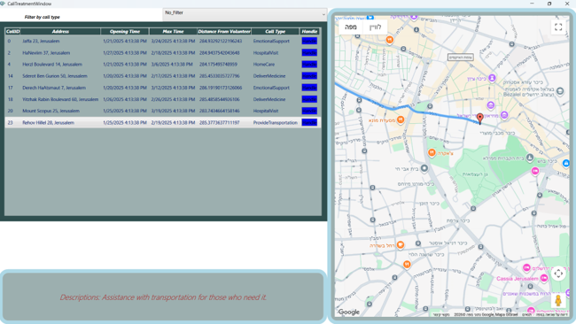
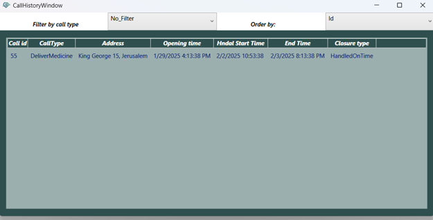

# VolunteerCare - Volunteer & Call Management System

VolunteerCare is a comprehensive desktop application built with C# and WPF (.NET). It is designed to streamline the dispatch and management of volunteers for various support calls, featuring real-time geographical tracking, assignment management, and a dedicated workspace for both managers and volunteers.

##  System Architecture

This project is engineered using a robust **3-Tier Architecture**, strictly enforcing the Separation of Concerns (SoC). This structural design ensures high scalability, code maintainability, and seamless feature expansion.

### 1. Presentation Layer (PL) - Interactive UI
* **Technology Stack:** Developed using **WPF (Windows Presentation Foundation)** and **XAML** to create a rich, responsive, and native Windows desktop experience.
* **State Management:** Implements `DependencyProperty` and Data Binding to ensure smooth synchronization between the backend data and the UI controls.
* **Thread Safety:** Utilizes `Dispatcher.BeginInvoke` for safe, asynchronous UI updates directly from background business processes.

### 2. Business Logic Layer (BL) - Core Engine
* **Design Patterns:** Implements the **Observer Pattern** to push real-time updates to the UI, and the **Factory Pattern** (`BlApi.Factory.Get()`) for abstracted, secure object instantiation.
* **Algorithmic Processing:** Handles complex system algorithms, including calculating geographical distances between active volunteers and open calls to optimize dispatching.
* **Validation & Rules:** Enforces strict business rules, data validation, and manages the logical workflow (e.g., preventing the deletion of assigned calls and managing risk-state timers).

### 3. Data Access Layer (DAL) - Persistence
* **Data Storage:** Manages reliable data persistence utilizing **XML Serialization** (and/or relational databases).
* **Decoupling:** Operates behind strict interfaces (API contracts), ensuring the BL remains completely agnostic to the underlying storage mechanism.
* **CRUD Operations:** Exposes a seamless, optimized, and thread-safe API to execute Create, Read, Update, and Delete operations while safeguarding data integrity.
---

## Key Features & Screenshots

### 1. Authentication
Secure login system distinguishing between Administrators and Volunteers.

### 2. Manager Dashboard & Simulator
Central hub for managers to oversee the system, adjust configurations (like Risk Ranges), and run a time-advancement simulator to test call expiration and risk states.

### 3. Volunteer Management
Comprehensive grid to view, filter, and manage all registered volunteers, including their handled calls and duty status.

### 4. Call Management
Dynamic list tracking all open and in-progress calls, sorted by urgency and status, preventing deletion of assigned calls.

### 5. Volunteer Workspace
A dedicated view for volunteers to monitor their active assignments, update their availability, and review their history.

### 6. Interactive Geographical Tracking (API Integration)
Integration with **Google Maps API** via `Microsoft.Web.WebView2`. Volunteers can view their current location, nearby open calls, and calculate driving routes directly within the app.

### 7. Call History
Detailed logs for volunteers to review previously handled calls and their resolution times.

---

## Required Packages (Manual Setup)

This project utilizes two external UI and functionality packages. If Visual Studio does not restore them automatically, please follow these steps:

**1. Extended.Wpf.Toolkit (v4.6.1)**
Used for advanced UI controls like DateTimePicker and Watermarks.
*   Copy all `.dll` files from the `addons -> Xceed` folder in the project directory into the target `bin` folder.

**2. Microsoft.Web.WebView2**
Used to render the interactive Google Maps interface.
*   Copy all files from the `addons -> WebView2` folder in the project directory into the target `bin` folder.

## Google Maps Configuration

For security reasons, the Google Maps API key is not included in this repository. 
To enable the interactive map feature:
1. Locate `api_key.example.txt` in the root/bin directory.
2. Rename the file to `api_key.txt`.
3. Replace the placeholder text with your own Google Maps API Key.
*(Note: If the key is missing, the application will gracefully disable the map view while all other management features remain fully functional).*
